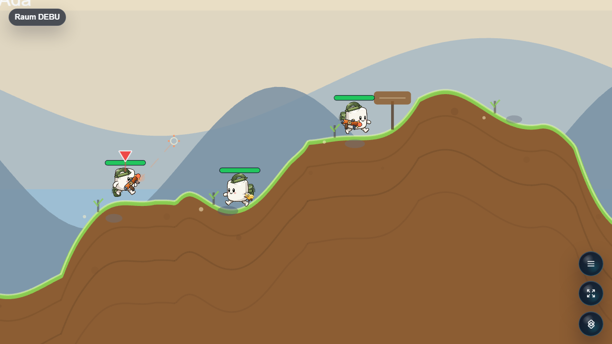

# Chaos-Kommando

Turn-based cartoon artillery game for Open Party Lab with mercenaries, wild weapons, and destructible terrain.



## Status

Alpha. Supports **2–6 teams, three commandos per team**.

- The three coastal arenas now use a **3200×1600** world. Ground terraces, two large floating rock islands and two smaller islands above them form three height levels. Four distinct polygon contours replace the oval upper slabs, with broken edges, broad walkable tops and irregular undersides. They float freely without supporting columns and remain destructible. Safe starting positions include all three levels, with full foot support, side clearance and at least 74 pixels between units.
- The camera follows the active commando, rope anchor and projectiles at a readable scale. A terrain minimap shows all teams and the current viewport; clicking it or pressing M toggles the full-arena overview. Normal state updates no longer snap the camera position. The title, active commando, turn time and six team health strips have separate spaces.
- Stone silhouettes and layered shading replace green outlines on vertical cliffs. Grass, hanging leaves, flowers and palms grow on ledges; destroying a palm's root removes it. Floating rocks and all new decoration are cut by the same crater mask as the collision terrain. Original generated coastal background and sandstone art remain in use.
- Host-only position smoothing, distance-driven steps, local foot contact and landing dust refine movement. Jump poses tuck limbs without adding a second visual jump above the simulated body. Walking speed is 85 px/s. The forward jump uses a 390 px/s upward impulse and 195 px/s forward boost; the high backflip uses 600 px/s upward with a compact 40 px/s backward boost. Walking turns the aim with the commando.
- Held guns remain in the hands while walking. Sprite barrels, aiming marks, muzzle flashes and server projectile origins share one geometry contract, including left-facing and vertical aim. A muzzle obstruction cannot spawn a shot on the far side of a wall.
- Authoritative attack events drive individual minigun rounds, recoil, muzzle flashes and ejected casings. Skipping or taking fall damage does not fake a shot. Grenades leave the hand when released. Smoke trails fill gaps between snapshots and fade after impact; a restrained crosshair and ten-segment power meter replace the glowing charge beam.
- All weapon families have playable starting ammo. Drill rockets cut long tunnels; direct gun hits make sparks instead of excavating rocket craters. Heavy explosives carve irregular holes, throw dirt and display damage numbers.
- A turn has 2 seconds of preparation and 30 seconds of control. One attack starts a **3-second retreat immediately on release**, followed by settling of shots, falls, mines and death sequences. Injury ends the active turn. Sudden death starts after at least 16 turns (24 for six teams) and raises the water.
- Phone controls add dedicated Hook / Release and hold-to-Pull-Up buttons alongside movement/aim sticks, arsenal, hop/backflip, grenade fuses and End Turn. Quick-hook searches overhead undersides before falling back to the aimed ray, reaches up to 900 pixels, and preserves the selected combat weapon. Reeling pulls at 240 px/s; stick movement swings, jump launches off the rope, and a clear cliff lip permits climbing onto its ledge. Body collision prevents passage through rock ceilings. Each commando starts with 12 hooks. The rope cannot bypass a spent attack. The host and phone now use the platform-synchronized server clock for turn/retreat timing, including immediate control locking at a deadline.

The modular marshmallow character artwork is retained and reanimated. Environmental art provenance is in `public/host/chaos-kommando/environment/v2/ASSET-SOURCE.md`; the new palm and grass sprites and their prompts are documented in `environment/v3/ASSET-SOURCE.md`. Their placement follows the procedural terrain and crater mask. Physical six-phone sessions and final weapon/map balance still need playtesting.

Reference mechanics: [Team17 Armageddon controls](https://wa.worms2d.info/main.html?area=cont&page=abou), [Team17 W.M.D](https://www.team17.com/games/worms-w-m-d). Original code and artwork; no third-party game assets.

Verification: 26 rule/presentation tests pass, including six-team spawning across 30 seeds, every starting backflip in both directions, muzzle alignment, obstructed barrels, burst events, foot contact, snapshot smoothing, clock skew, ceiling grappling, reeling, rope jumps, cliff mantling, reachable overhead anchors and starts on all three height levels of every map. Platform typecheck and full build pass. In-app checks covered the six-team arena, movement, jumping, attachment to a floating-rock underside, held reeling, the three-level overview and the new controls at 390×844. Physical devices and complete weapon/map balance remain unverified.

## Run Through Open Party Lab

This repo is not a standalone app. Run it through the Open Party Lab platform.

Recommended layout:

```text
Open-Party-Lab/
  local-games/
    chaos-kommando/
```

From the Platform repo:

```bash
npm install
npm run games:sync-local
npm run dev:all
```

The Platform loads this game only when the repo exists locally and `npm run games:sync-local` links it. Missing optional games are skipped.

## GitHub Metadata

Description:

```text
Turn-based cartoon artillery game for Open Party Lab with mercenaries, wild weapons, and destructible terrain.
```

Suggested topics:

```text
open-party-lab party-game browser-game phaser typescript local-multiplayer artillery-game
```

## Package Entrypoints

- `@open-party-lab/game-chaos-kommando/manifest`
- `@open-party-lab/game-chaos-kommando/protocol`
- `@open-party-lab/game-chaos-kommando/server`
- `@open-party-lab/game-chaos-kommando/host`
- `@open-party-lab/game-chaos-kommando/controller`

The Platform should import only these public entrypoints.

## Development Checks

```bash
npm install
npm run typecheck
npm run test
npm run build
npm run pack:dry-run
```

For visual checks, start Open Party Lab, add virtual controllers when needed, and capture host screenshots through a browser.

## License

Code is licensed under the Apache License 2.0. See [LICENSE](LICENSE).

Assets, generated media, word lists, prompts, and third-party references may need separate rights review before public store distribution.
